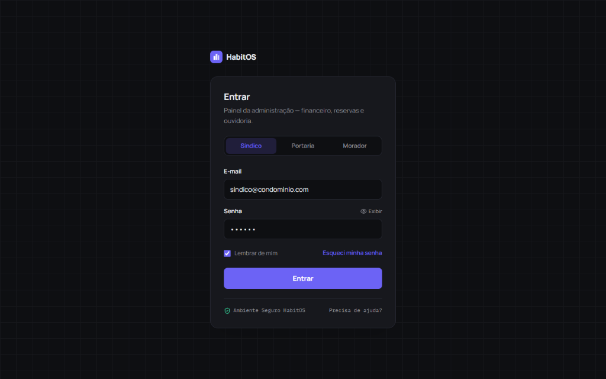
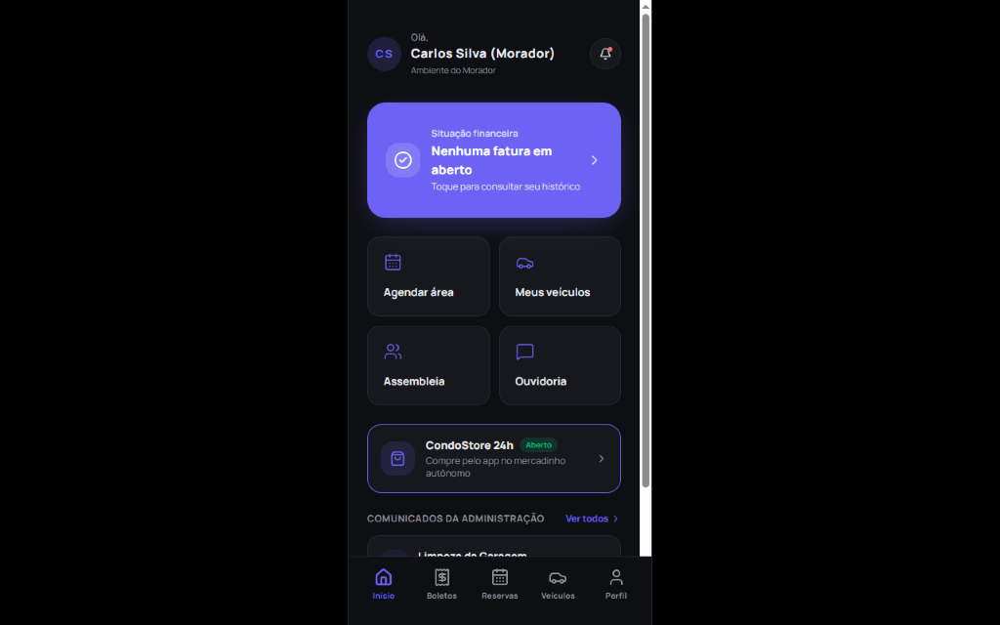
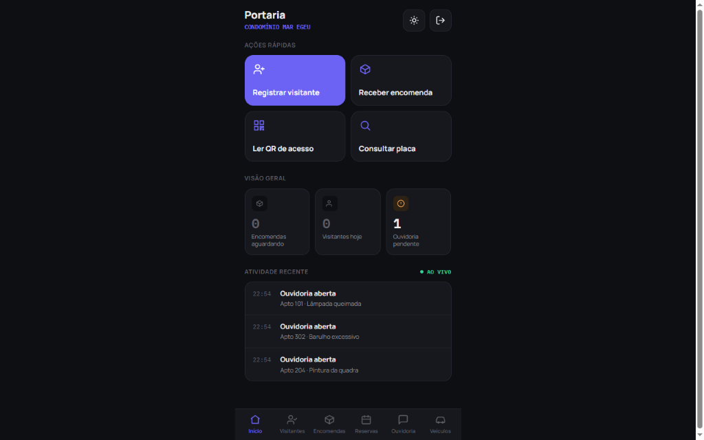

# HabitOS Web (CondoEconomy)

Plataforma web **mobile-first** para a gestão operacional, financeira e comunicacional de condomínios, conectando **Moradores**, **Portaria** e **Síndico / Administração** em uma experiência unificada de alta densidade informacional e segurança em camadas.

## Prévia Visual

| Acesso por Perfil (Login) | Aplicativo do Morador |
| :---: | :---: |
|  |  |
| **Painel da Portaria (Tempo Real)** | **Painel do Síndico (Administração)** |
|  |  |

---

## Stack Tecnológica

- **React 19 (`^19.2.8`)** com **TypeScript 6 (`~6.0.2`)**
- **Vite 8 (`^8.2.2`)** para empacotamento e HMR instantâneo
- **Tailwind CSS v4 (`^4.3.3`)** com Design System semântico próprio (Modo Claro e Escuro nativos + tipografia `Inter` e `DM Mono`)
- **React Router DOM v7 (`^7.18.3`)** com carregamento sob demanda (`React.lazy` / `Suspense`) e proteção de rotas via `AuthGuard`
- **Axios (`^1.20.0`)** com interceptadores de sessão (`Bearer JWT` + `Cookie HttpOnly` com `withCredentials: true`)
- **STOMP over WebSocket (`@stomp/stompjs ^7.3.0`)** autenticado via JWT no frame `CONNECT` para atualizações em tempo real
- **PWA (`vite-plugin-pwa ^1.3.0`)** com Service Worker e manifesto instalável
- **QR Code (`qrcode.react` e `html5-qrcode`)** para emissão e leitura de credenciais de acesso na portaria
- **Oxlint (`^1.79.0`)** para análise estática ultrarrápida

---

## Design System & Catálogo de Componentes

A interface implementa integralmente a especificação [CONDOECONOMY_DESIGN_SPEC.md](docs/design/CONDOECONOMY_DESIGN_SPEC.md) em um shell mobile-first de `412px` (`MobileFrame`) com **21 componentes base** em `src/components/ui/`:

- **Navegação & Layout:** `MobileFrame`, `AppHeader`, `BottomNav`, `PageHead`
- **Superfícies & Listas:** `ListCard`, `GroupedList`, `ListRow`, `KpiTile`, `SegmentBar`
- **Ações & Formulários:** `Button`, `IconButton`, `Field`, `TextAreaField`, `SearchInput`, `FilterChips`, `ChoiceChips`, `SegmentedTabs`, `Toggle`
- **Feedback & Modais:** `Badge`, `IconChip`, `Avatar`, `ProgressBar`, `LiveIndicator`, `EmptyState`, `BottomSheet`, `ConfirmSheet`, `InlineConfirm`, `Thread`, `Toast`

> **Catálogo interativo:** Com a aplicação em execução, acesse `/design-system` para inspecionar os componentes ao vivo.

---

## Módulos e Telas por Persona (25+ Telas)

### 1. Morador (`/app/*`)
- **Home (`/app`):** Saudação contextual (`Bloco · Apto`), alternância de tema Claro/Escuro, sino de notificações com indicador em tempo real, atalhos rápidos, alertas acionáveis e mural de comunicados com confirmação de leitura.
- **Notificações (`/app/notificacoes`):** Central de alertas com filtro por categoria e marcação em lote (`"Marcar todas como lidas"`).
- **Boletos (`/app/boletos`):** Resumo financeiro, cálculo automático de multa (`2%`) e juros (`1% a.m.`) em boletos vencidos, cópia de linha digitável/PIX e impressão de comprovante digital protegido contra DOM XSS.
- **Reservas (`/app/reservas`):** Solicitação de áreas comuns com verificação de janela de horário (`início`–`fim`), capacidade máxima, lista de convidados e exibição de motivo em caso de recusa.
- **Visitantes (`/app/visitantes`) & Encomendas (`/app/encomendas`):** Pré-autorização de visitas/prestadores com QR Code e rastreio de pacotes recebidos na portaria.
- **Assembleia Virtual (`/app/assembleia`):** Votação em pautas ativas em tempo real, barra de quórum e consulta de atas encerradas.
- **Ouvidoria (`/app/ouvidoria`):** Abertura de chamados por categoria (`Reclamação`, `Manutenção`, `Sugestão`, `Dúvida`, `Segurança`, `Elogio`), anexo de foto e conversa (`Thread`) com portaria e síndico.
- **CondoStore (`/app/condostore`):** Vitrine e pedidos no minimercado autônomo do condomínio.
- **Perfil e Subtelas (`/app/perfil/*`):**
  - QR Code de acesso da unidade em `BottomSheet`
  - **Dados Pessoais (`/app/perfil/dados`)**
  - **Meus Veículos (`/app/veiculos`)**
  - **Meus Pets (`/app/pets`)**
  - **Moradores da Unidade (`/app/moradores`)** com controle de acesso ao app
  - **Notificações (`/app/perfil/notificacoes`)** (preferências granulares Push/E-mail)
  - **Segurança (`/app/perfil/seguranca`)** (troca de senha com *Step-Up Auth*, *Kill Switch* para encerrar outras sessões e histórico forense de acessos)
  - **Privacidade & LGPD (`/app/perfil/privacidade`)** (portabilidade de dados pessoais em JSON conforme Art. 18 da LGPD)
  - **Central de Ajuda (`/app/perfil/ajuda`)**

### 2. Portaria (`/portaria/*`)
- **Painel Operacional (`/portaria`):** Indicador `Ao vivo`, KPIs do turno, fila prioritária de atenção imediata (`>= 5 min` visitante aguardando, `>= 3 dias` encomenda parada, `>= 3 h` chamado sem resposta) e atalhos rápidos.
- **Visitantes (`/portaria/visitantes`):** Registro de entrada (`Check-in`) e saída (`Check-out`), scanner de QR Code e cadastro manual.
- **Encomendas (`/portaria/encomendas`):** Recebimento com `ChoiceChips` de transportadora e confirmação de retirada (`O próprio destinatário` ou `Outra pessoa`).
- **Reservas do Dia (`/portaria/reservas`):** Controle de presença (`Check-in`) na lista de convidados e inclusão de convidados extras autorizados na portaria.
- **Chamados da Portaria (`/portaria/chamados`):** Atendimento de ocorrências, conversa (`Thread`) com o morador e escalonamento para o síndico com `Nota da portaria` obrigatória.
- **Consulta de Veículos (`/portaria/veiculos`):** Busca instantânea por placa, modelo ou unidade (`font-mono` em caixa alta) cruzando frota de moradores e veículos de visitantes do dia.

### 3. Síndico / Administração (`/admin/*`)
- **Visão Geral & Comunicados (`/admin`):** 4 KPIs executivos, fila de atenção do síndico (chamados escalonados ou abertos há `>= 24 h`, reservas pendentes), gestão de comunicados oficiais (com tag `Urgente`, fixação no topo e contador de leituras) e atalhos administrativos.
- **Aprovação de Reservas (`/admin/reservas`):** Aprovação com 1 toque ou recusa com motivo obrigatório em `ConfirmSheet`.
- **Assembleias (`/admin/assembleia`):** Criação e encerramento de pautas com quórum configurável e emissão de Ata Oficial em PDF.
- **Ouvidoria do Síndico (`/admin/ouvidoria`):** Gestão de chamados escalonados com leitura da nota da portaria, histórico de mensagens (`Thread`) e resolução/reabertura.
- **Finanças (`/admin/financas`):** Resumo de caixa, barra segmentada de adimplência, emissão de boletos, lançamento/pagamento de despesas, exportação de balancete CSV e **baixa manual com Step-Up Authentication** (confirmação de senha do síndico).
- **Gestão de Moradores (`/admin/moradores`):** Cadastro individual, bloqueio/ativação instantânea de contas e **importação em lote via planilha CSV**.
- **Estoque CondoStore (`/admin/condostore`):** Cadastro de produtos, reposição rápida e baixa de estoque com `InlineConfirm`.
- **Auditoria de Segurança (`/admin/auditoria`):** Console forense com busca e filtro por severidade (`INFO`, `ALERTA`, `CRITICO`).

### 4. Rotas Públicas
- **Login (`/login`):** Autenticação com recuperação de senha via código OTP de 6 dígitos e Central de Acesso.
- **Auto Check-in de Visitantes (`/visitante/auto-checkin`):** Pré-cadastro público via totem/QR Code na portaria com proteção de rate limit.

---

## Segurança no Front-end (AppSec)

- **Sanitização & Validação Defensiva ([src/utils/security.ts](src/utils/security.ts)):** Bloqueio preventivo de vetores XSS/SQLi e caracteres de controle antes do envio à API.
- **Prevenção de DOM XSS em Relatórios Impressos ([src/utils/escapeHtml.ts](src/utils/escapeHtml.ts)):** Escape estrito de entidades HTML em janelas de impressão de boletos e atas de assembleia.
- **WebSocket Autenticado ([src/hooks/useWebSocket.ts](src/hooks/useWebSocket.ts)):** Envio de `Authorization: Bearer <token>` no handshake STOMP `CONNECT` e seleção automática `ws://` / `wss://`.
- **Revogação Criptográfica no Logout:** O logout aciona `POST /api/v1/auth/logout`, incrementando o `tokenVersion` no servidor e limpando credenciais locais.
- **Política de Segurança:** Consulte [SECURITY.md](SECURITY.md) para diretrizes de divulgação responsável, cabeçalhos HTTP e checklist de produção.

---

## Como Executar Localmente

### Pré-requisitos
- **Node.js 20+** e **npm**
- **HabitOS API (`condoeconomy-api`)** em execução na porta `8080`

### Passo a Passo

1. Instale as dependências:
```bash
npm install
```

2. (Opcional) Configure a URL da API copiando `.env.example` para `.env`:
```bash
cp .env.example .env
```

3. Inicie o servidor de desenvolvimento:
```bash
npm run dev
```

4. Acesse no navegador:
```text
http://localhost:5173
```

### Scripts Disponíveis
- `npm run dev` — Inicia o servidor Vite com HMR na porta `5173`
- `npm run build` — Executa a checagem de tipos (`tsc -b`) e gera o bundle de produção + Service Worker PWA em `dist/`
- `npm run lint` — Executa o linter estático `oxlint`

---

## Credenciais de Homologação (Ambiente Local)

A senha padrão para todas as contas abaixo é **`123456`**:

| Perfil | Nome | E-mail | Rota Inicial |
| :--- | :--- | :--- | :--- |
| **Morador** | Carlos Silva (Morador) | `carlos.silva@email.com` | `/app` |
| **Portaria** | Porteiro de Teste | `porteiro@condominio.com` | `/portaria` |
| **Síndico** | Ana Laura (Síndica) | `sindico@condominio.com` | `/admin` |
